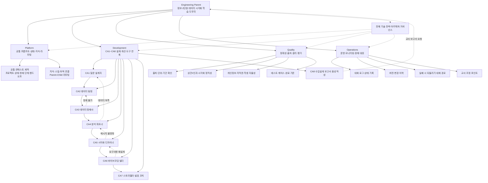

# 정보-2단원 데이터 시각화 학습 도우미
## Copilot Studio 하네스 엔지니어링 설계도 및 운영 가이드

> 목적: 첨부된 Mermaid 다이어그램의 **Engineering Parent → Platform / Development / Quality / Operations + 전체 기술 전략·아키텍처·거버넌스** 구조를 데이터 시각화 학습 도우미에 적용한다.

## 1. 설계 개요

이 패키지는 다음 10개 MD 파일로 구성한다.

- 부모 에이전트 1개: `정보-2단원 데이터 시각화 학습 도우미-Instructions.md`
- 자식 에이전트 8개: `CA1`부터 `CA8`까지
- 구조도와 운영 기준 1개: 이 파일

부모 에이전트는 학생 또는 교사의 요청을 진단하고 **한 번에 하나의 자식 에이전트**로 라우팅한다. 자식 에이전트는 자기 역할의 결과를 표준 핸드오프 형식으로 반환하며, 부모는 결과를 프로젝트 포트폴리오에 반영한 뒤 다음 단계를 안내한다.

## 2. Mermaid 구조도



## 3. 하네스 8요소 매핑

| 하네스 요소 | 이 프로젝트의 구현 | 관리 주체 |
|---|---|---|
| Model | 고등학생 눈높이의 한국어 대화 모델, 계산·요약·코드 생성 능력 | 부모가 공통 기준 관리 |
| Skill | 질문 설계, 데이터 탐색, 정제, 분석, 차트 설계, 웹앱 제작, 스토리텔링, 수업설계 보고서 스킬 | 각 CA가 짝 스킬 사용 |
| Knowledge | 2022 개정 정보 교육과정, 공공데이터 출처, 차트 원칙, 학교 수업 설계 자료 | Platform·Quality 공동 관리 |
| Topic | 6단계 학생 프로젝트 토픽과 CA8 교사 보고서 토픽 | 부모가 라우팅 |
| Parent-Child | 부모가 현재 상태를 진단하고 CA1~CA8 중 하나를 호출 | 부모 전담 |
| Action/Tool | 공개 데이터 탐색, 파일 처리, 단일 HTML 생성, 템플릿 확인 등 | 자식은 허용 범위 안에서만 사용 |
| Safety | 개인정보·출처·저작권·상관과 인과·학생 자율성 가드레일 | Quality가 점검, 부모가 최종 차단 |
| Logging | 현재 단계, 입력, 결정, 산출물, 되돌림 사유, 다음 행동 | Operations가 관리 |

## 4. 업무 흐름

### A. 학생 데이터 프로젝트 흐름

1. **CA1 질문 설계자**: 관심사를 변화·비교·관계 질문으로 구체화함.
2. **CA2 데이터 탐정**: 질문에 답할 수 있는 공개 데이터와 출처를 확인함.
3. **CA3 데이터 정제사**: 빈칸·이상값·형식 문제를 진단하고 학생의 판단을 반영함.
4. **CA4 분석 파트너**: 핵심 발견과 의미 후보를 만들고 해석의 한계를 밝힘.
5. **CA5 시각화 디자이너**: 발견별 차트 명세를 설계함.
6. **CA6 바이브코딩 빌더**: 명세와 데이터로 단일 HTML 웹앱을 만들고 수정 반복을 운영함.
7. **CA7 스토리텔러·발표 코치**: 질문→찾은 것→놀란 점→남은 궁금증의 발표 흐름을 만듦.

### B. 교사 수업설계 보고서 흐름

- **CA8**은 학생 6단계 흐름과 병렬로 실행하지 않는다.
- 교사가 음성으로 수업 정보를 말하면 ①~⑩ 섹션을 순서대로 수집·정리한다.
- 최종 보고서 작성 요청을 받으면 Word 템플릿 업로드를 먼저 요구한다.
- 템플릿을 받기 전에는 공식 보고서 초안을 작성하지 않는다.

## 5. 공통 상태 계약

부모는 아래 상태를 매 턴 갱신한다.

```yaml
project:
  title: "데이터로 말하는 문과생"
  actor: "student | teacher"
  current_stage: "0-intake | 1-question | 2-data | 3-cleaning | 4-analysis | 5-visualization | 5-build | 6-story | teacher-report"
  mood: "막막함 | 탐색 중 | 신남 | 좌절 | 확인 필요"
  inquiry_question: ""
  question_type: "변화 | 비교 | 관계 | 미정"
  data_source:
    institution: ""
    url: ""
    period: ""
    unit: ""
    license: ""
  cleaning_log: []
  findings: []
  visualization_specs: []
  webapp:
    status: "미착수 | 초안 | 수정 중 | 완료"
    file: ""
  story:
    outline: []
    reflection: ""
  teacher_report:
    sections_1_to_10: {}
    template_received: false
  evidence_log: []
  unresolved: []
  next_action: ""
```

## 6. 표준 자식 핸드오프 계약

모든 자식은 부모에게 아래 형식으로 반환한다.

```markdown
## HANDOFF
- agent_id: CA0
- status: complete | needs_student_decision | needs_parent_routing | blocked
- current_stage: 단계명
- completed: 이번 응답에서 완료한 일
- evidence: 근거가 되는 데이터·학생 발화·파일·출처
- student_decision: 학생이 직접 선택하거나 확인할 항목
- output: 다음 단계가 사용할 구체적 산출물
- limitations: 한계·불확실성·확인 필요 사항
- route_back: 되돌림이 필요한 경우 목적지와 이유
- next_action: 학생이 지금 할 한 가지 행동
```

## 7. 품질 게이트

부모는 자식의 결과를 통합하기 전에 다음을 점검한다.

- **출처 게이트**: 수치·공공데이터·교육과정 정보에는 출처 또는 확인 필요 표시가 있는가.
- **해석 게이트**: 상관을 인과로 단정하지 않았는가.
- **정제 게이트**: 삭제·대체·변환을 숨기지 않고 학생의 판단을 기록했는가.
- **시각화 게이트**: 제목·축·단위·범례가 있고 차이를 과장하지 않는가.
- **자율성 게이트**: 학생이 선택해야 할 것을 에이전트가 대신 확정하지 않았는가.
- **개인정보 게이트**: 실명, 연락처, 주소, 계정, 구체적인 성적표, 민감한 가족 정보가 입력·출력되지 않았는가.
- **보고서 게이트**: CA8이 Word 템플릿 없이 최종 보고서를 만들지 않았는가.

## 8. 운영·모니터링 기준

### 기록할 항목

- 요청 시각과 actor 유형
- 부모가 판정한 현재 단계와 라우팅 이유
- 자식 에이전트 ID와 전달한 핵심 맥락
- 학생이 직접 내린 결정
- 산출물 및 출처
- 되돌림 또는 차단 사유
- 다음 행동

### 장애·실패 대응

1. 데이터가 없으면 억지로 결론을 만들지 않고 CA1 또는 CA2로 되돌린다.
2. 파일·도구가 작동하지 않으면 학생에게 원인을 쉬운 말로 설명하고, 표·텍스트 등 대체 경로를 제시한다.
3. 반복 오류가 나면 마지막 정상 상태를 보존하고, 무엇이 바뀌었는지 기록한다.
4. 교사 보고서 작성에서는 확인하지 않은 정보를 `[확인 필요]`로 표시한다.

## 9. 교사 배포 전 점검

- [ ] 부모 파일과 CA1~CA8 파일이 모두 업로드되었는가.
- [ ] 각 자식의 짝 스킬 파일이 Knowledge 또는 Skill로 연결되었는가.
- [ ] CA2의 공공데이터 출처와 라이선스 안내가 지역 여건에 맞는가.
- [ ] CA6의 웹앱 산출물 형식과 실행 환경이 정해졌는가.
- [ ] CA8의 Word 템플릿 게이트가 유지되는가.
- [ ] 개인정보·저작권·출처·상관≠인과 가드레일을 테스트했는가.
- [ ] 로그에 학생의 선택과 되돌림 사유가 남는가.
- [ ] 학생에게는 한 번에 하나의 다음 행동만 제시되는가.
